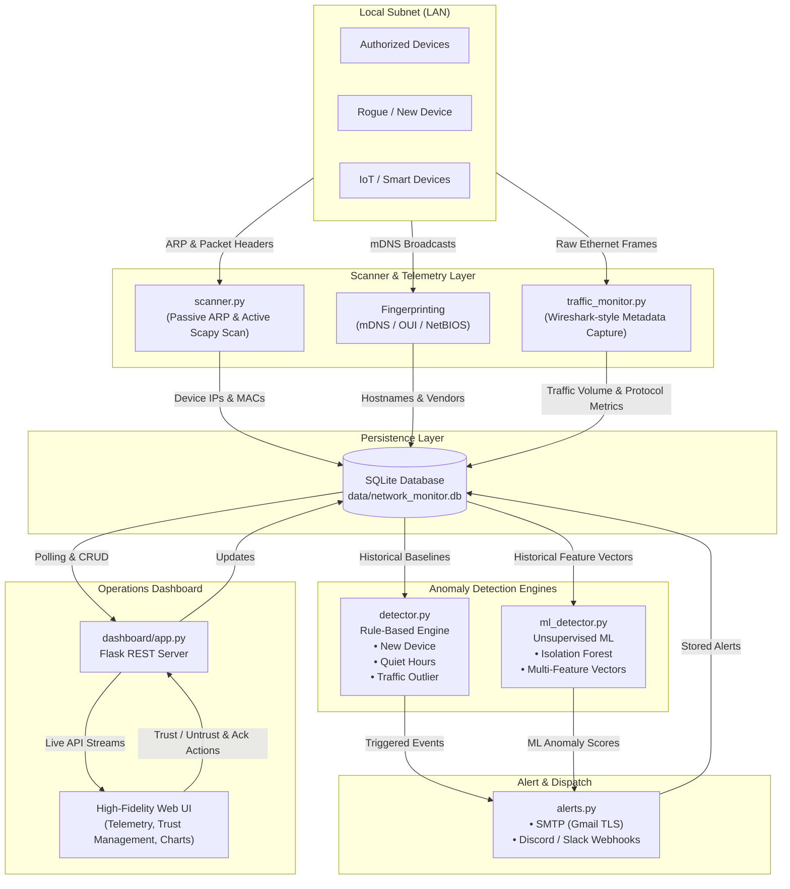

# 🛡️ NetSentry — Network Monitor & Intrusion Detection System

[](https://www.python.org/)
[](https://flask.palletsprojects.com/)
[](https://scapy.net/)
[](https://scikit-learn.org/)
[](https://www.sqlite.org/)

**Sentinel** is an intelligent, lightweight Local Area Network (LAN) surveillance and anomaly detection system. It continuously discovers connected devices, fingerprints hardware vendors and hostnames, monitors packet traffic volumes, learns baseline device behavior using **unsupervised Machine Learning (Isolation Forests)**, and flags rogue hosts or anomalous activity via an interactive real-time SOC dashboard and multi-channel alerts (Email & Discord).

---

## 📑 Table of Contents

- [System Architecture](#-system-architecture)
- [Key Features](#-key-features)
- [Project Structure](#-project-structure)
- [Prerequisites & Requirements](#-prerequisites--requirements)
- [Installation & Quickstart](#-installation--quickstart)
- [Configuration Guide](#-configuration-guide)
- [Dashboard & Web UI](#-dashboard--web-ui)
- [REST API Reference](#-rest-api-reference)
- [Troubleshooting & FAQ](#-troubleshooting--faq)
- [Legal, Privacy & Security Notice](#-legal-privacy--security-notice)

---

## 🏛️ System Architecture

Sentinel is organized into a modular pipeline where network telemetry, detection engines, storage, and visual presentation operate seamlessly:



---

## ✨ Key Features

### 1. Dual-Mode Device Discovery
- **Passive ARP Table Mode:** Runs without administrative rights by reading the local OS ARP cache. Ideal for zero-friction setup.
- **Active Scapy ARP Sweep:** Broadcasts ARP queries across the subnet (`/24`) to identify silent, idle, or uncommunicative devices.

### 2. Multi-Vector Device Fingerprinting
- **mDNS Service Discovery:** Discovers friendly broadcast names (`_airplay`, `_googlecast`, `_http`, `_ipp`, `_workstation`, `_androidtvremote2`) using `zeroconf`.
- **Integrated OUI Database:** Recognizes hardware manufacturers offline across thousands of vendor MAC prefixes (`oui_database.py`).
- **Online Fallback:** Automated fallback to `api.macvendors.com` for unrecognized prefixes (cached to avoid rate limits).
- **Randomized MAC Detection:** Checks the locally administered MAC address bit (`x2`, `x6`, `xA`, `xE`) to spot randomized client hardware.

### 3. Privacy-Preserving Traffic Telemetry
- **Header-Only Inspection:** Captures packet length, source, destination, protocol, and port numbers without ever reading, storing, or inspecting sensitive application payloads.
- **Protocol Classification:** Classifies traffic into HTTP, HTTPS, DNS, SSH, DHCP, NTP, RDP, MySQL, and generic ports.
- **Per-Device Accounting:** Aggregates byte counts, packet counts, and unique destination counts per scan cycle.

### 4. Dual-Engine Anomaly Detection
- **Rule-Based Engine (`detector.py`):**
  - `NEW_DEVICE`: Instant alert on any previously unseen MAC address joining the subnet.
  - `QUIET_HOURS`: Flags non-baseline (untrusted) devices transmitting during configurable off-hours (default: 1:00 AM – 5:00 AM).
  - `TRAFFIC_OUTLIER`: Flags any device exceeding a multiplier (default: 3.0×) of its historical bandwidth average.
- **Unsupervised Machine Learning Engine (`ml_detector.py`):**
  - Powered by **Isolation Forest** algorithms (`scikit-learn`), trained individually per device.
  - Multi-dimensional feature analysis: `[bytes_transferred, packet_count, unique_destinations, hour_of_day]`.
  - Self-adapting baseline retraining every 10 scan cycles with cooldown timers to prevent notification storms.
  - Real-time training progress tracking via the CLI tool `ml_status.py`.

### 5. Cyber Operations Dashboard
- High-performance, dark-themed SOC interface built with vanilla HTML5/CSS and Chart.js.
- **Device Management:** One-click baseline toggle (**Trust** / **Untrust** devices).
- **Incident Center:** Severity-tagged alert feed with single-alert and batch acknowledgement.
- **Traffic Analytics:** Visual protocol distribution donut chart and bandwidth telemetry.
- **Inspection Feed:** Real-time stream of recent packet headers.

### 6. Multi-Channel Alerting
- Direct dispatch to **SMTP Email** (e.g., Gmail with TLS and App Passwords).
- Instant webhooks for **Discord** and **Slack** channels.

---

## 📁 Project Structure

```text
network_monitor/
├── dashboard/
│   ├── app.py                      # Flask backend API server (port 5000)
│   └── templates/
│       └── index.html              # Modern dark-mode SOC dashboard & Chart.js UI
├── data/
│   └── network_monitor.db          # SQLite persistent database (auto-created)
├── scanner/
│   ├── alerts.py                   # SMTP Email & Discord webhook dispatch logic
│   ├── db.py                       # Database abstraction layer and schema migrations
│   ├── detector.py                 # Rule-based anomaly detection engine
│   ├── main.py                     # Primary monitoring loop orchestration
│   ├── ml_detector.py              # Scikit-learn Isolation Forest anomaly detector
│   ├── ml_status.py                # CLI utility to monitor ML training & baseline readiness
│   ├── oui_database.py             # Offline IEEE OUI MAC vendor lookup dictionary
│   ├── scanner.py                  # Passive & Active ARP scanner + mDNS resolver
│   └── traffic_monitor.py          # Scapy packet header sniffer & protocol classifier
├── requirements.txt                # Core Python package dependencies
└── README.md                       # System documentation
```

---

## 📦 Prerequisites & Requirements

### Software Requirements
- **Python 3.8+** (64-bit recommended)
- **Windows:** [Npcap](https://npcap.com/#download) installed with **"Install Npcap in WinPcap API-compatible Mode"** checked (required for Scapy raw socket active scanning and packet capture).
- **Linux:** Root privileges (`sudo`) and `libpcap-dev` installed:
  ```bash
  sudo apt-get update && sudo apt-get install -y libpcap-dev
  ```

---

## 🚀 Installation & Quickstart

### 1. Clone & Set Up Virtual Environment

```bash
# Navigate to the repository root
cd network_monitor

# Create and activate a Python virtual environment
python -m venv venv

# Windows (Command Prompt / PowerShell):
.\venv\Scripts\activate

# Linux / macOS:
source venv/bin/activate
```

### 2. Install Dependencies

```bash
# Install core requirements (Flask, Scapy, Zeroconf)
pip install -r requirements.txt

# Install ML dependencies (Required for ml_detector.py Isolation Forest engine)
pip install scikit-learn numpy
```

### 3. Launching the Services

Sentinel runs as two concurrent processes: the **Scanner Engine** and the **Web Dashboard**.

#### Terminal 1 — Start the Network Monitor:
> **Note for Active Scanning & Packet Capture:** On Windows, run PowerShell / Command Prompt as **Administrator**. On Linux, run with `sudo`.

```bash
cd scanner
python main.py
```

*Safe Fallback:* If Scapy or Npcap is missing, Sentinel gracefully falls back to passive ARP table monitoring without crashing.

#### Terminal 2 — Start the SOC Dashboard:

```bash
cd dashboard
python app.py
```

Once started, open **[http://localhost:5000](http://localhost:5000)** in your browser. The dashboard automatically polls for live updates every 5 to 10 seconds.

#### Terminal 3 (Optional) — Inspect Machine Learning Status:

```bash
cd scanner
python ml_status.py
```

Outputs the exact sample collection progress (`MIN_SAMPLES = 50`), active models, and recent ML anomaly detections.

---

## ⚙️ Configuration Guide

Key operational parameters can be customized without modifying core logic:

### Scanner Settings (`scanner/main.py`)

| Constant | Default | Description |
|---|---|---|
| `SCAN_INTERVAL_SECONDS` | `30` | Interval between network sweeps in seconds. |
| `USE_ACTIVE_SCAN` | `True` | Broadcast ARP sweeps across `/24` subnet using Scapy. |
| `USE_ONLINE_VENDOR_LOOKUP`| `True` | Query `api.macvendors.com` if offline OUI table misses prefix. |
| `USE_TRAFFIC_CAPTURE` | `True` | Run background packet sniffer for byte and packet telemetry. |
| `USE_ML_DETECTION` | `True` | Run unsupervised Isolation Forest anomaly scoring. |

### Rule-Based Detection Thresholds (`scanner/detector.py`)

| Constant | Default | Description |
|---|---|---|
| `TRAFFIC_OUTLIER_MULTIPLIER` | `3.0` | Multiplier above baseline average to trigger `TRAFFIC_OUTLIER`. |
| `QUIET_HOURS_START` | `1` | Start of quiet hours (1:00 AM). |
| `QUIET_HOURS_END` | `5` | End of quiet hours (5:00 AM). |

### Machine Learning Parameters (`scanner/ml_detector.py`)

| Constant | Default | Description |
|---|---|---|
| `MIN_SAMPLES` | `50` | Cycles required before predicting (~25 min of baseline traffic). |
| `CONTAMINATION` | `0.01` | Expected outlier proportion in baseline training data (1%). |
| `HISTORY_LIMIT` | `500` | Maximum recent readings stored in sliding window per device. |
| `RETRAIN_EVERY` | `10` | Frequency of model retraining as new cycles arrive. |
| `COOLDOWN_MINUTES` | `10` | Cooldown period between ML alerts per device to avoid alert spam. |

### Alert Notifications (`scanner/alerts.py`)

Configure SMTP email and/or Discord webhook credentials:

```python
# SMTP Settings (e.g. Gmail App Password)
SMTP_SERVER = "smtp.gmail.com"
SMTP_PORT = 587
SMTP_USERNAME = "your_email@gmail.com"
SMTP_APP_PASSWORD = "your_16_char_app_password"
ALERT_RECIPIENT = "security_team@example.com"

# Discord Webhook Integration
DISCORD_WEBHOOK_URL = "https://discord.com/api/webhooks/your/webhook/url"
```

---

## 🖥️ Dashboard & Web UI

The Sentinel dashboard provides a unified pane of glass for network administrators:

- **Metrics Ribbon:** Real-time count of total devices, trusted baseline count, pending alerts, and network telemetry volume.
- **Device Inventory Table:**
  - MAC address, resolved IP, discovered hostname, vendor branding, and connection timestamps.
  - Security badges indicating **Trusted Baseline**, **Untrusted / Pending**, and **Randomized MAC**.
  - Interactive **Trust** / **Untrust** toggle buttons to baseline new devices.
- **Incident Feed:**
  - Real-time alert list categorized by alert type (`NEW_DEVICE`, `QUIET_HOURS`, `TRAFFIC_OUTLIER`, `ML_ANOMALY`).
  - Single-click acknowledgement (`Acknowledge`) and bulk acknowledgement (`Acknowledge All`).
- **Telemetry Visualizations:**
  - Dynamic Chart.js protocol breakdown (HTTPS, HTTP, DNS, SSH, etc.).
  - Recent packet inspection feed detailing timestamps, ports, and header byte sizes.

---

## 🔌 REST API Reference

The Flask backend (`dashboard/app.py`) exposes clean JSON endpoints utilized by the frontend and external automations:

### Devices & Baseline

- **`GET /api/devices`**
  - Returns a list of all discovered devices with baseline status, vendor, hostname, and timestamps.
- **`POST /api/trust/<mac>`**
  - Marks the specified MAC address as a trusted baseline device.
- **`POST /api/untrust/<mac>`**
  - Revokes baseline trust from the specified MAC address.

### Alerts & Incidents

- **`GET /api/alerts`**
  - Returns all unacknowledged and recent network alerts.
- **`POST /api/alerts/<id>/ack`**
  - Acknowledges an individual alert by its numeric ID.
- **`POST /api/alerts/ack-all`**
  - Bulk acknowledges all active alerts.

### Traffic Telemetry

- **`GET /api/traffic`**
  - Returns cumulative protocol byte breakdown and a rolling log of recent packet headers.

---

## ❓ Troubleshooting & FAQ

### 1. Active Scan or Traffic Sniffing throws permission errors
- **Windows:** Ensure [Npcap](https://npcap.com) is installed in WinPcap-compatible mode and open your terminal with **Run as Administrator**.
- **Linux:** Prefix the scanner command with `sudo`: `sudo python main.py`.

### 2. ML Detector status shows "collecting (X/50)"
- The Isolation Forest requires a minimum of 50 scan cycles (`~25-30 minutes`) to understand normal baseline variance before issuing judgments. You can monitor collection progress anytime using `python ml_status.py`.

### 3. Unknown Hostnames or Vendors
- Some devices (notably newer iOS, Android, and Windows clients) enable Private/Randomized MAC addressing by default and disable mDNS/NetBIOS responses. Sentinel detects randomized MACs and flags them with an indicator in the dashboard.

### 4. Gmail alerts failing with Authentication Error
- Normal passwords cannot be used with Google SMTP if 2-Step Verification is enabled. Generate an **App Password** via *Google Account Security > 2-Step Verification > App Passwords* and set it as `SMTP_APP_PASSWORD`.

---

## ⚖️ Legal, Privacy & Security Notice

> [!IMPORTANT]
> **Authorization & Compliance:** Network monitoring and packet sniffing should **only** be conducted on networks you own or have received **explicit, written authorization** to monitor (such as home laboratories, testing sandboxes, or designated academic lab networks). Capturing traffic on public or unauthorized corporate networks may violate legal statutes and organizational acceptable use policies.

> [!NOTE]
> **Privacy by Design:** Sentinel operates strictly on **network header metadata** (IPs, MACs, ports, protocols, byte sizes). It intentionally never reads, parses, decrypts, or stores the payload content of user communications.

